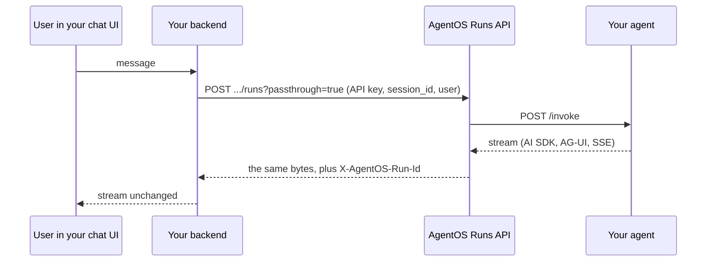

You do not need to rewrite an agent to run it on AgentOS. You wrap it in a container that answers the [agent contract](/agentos/build/agent-contract), and point its model calls at the gateway.

## The shape of the change

<Steps>
  <Step title="Serve the contract">
    Add `GET /health` and `POST /invoke`. With the Python or TypeScript SDK this is one `serve({...})` call. In another language it is two HTTP routes.
  </Step>
  <Step title="Point model calls at the gateway">
    Use `context.llm.base_url` as the OpenAI-compatible base URL and the model names from `context.config.models`. Your framework's own client works unchanged.
  </Step>
  <Step title="Describe it in agentos.yaml">
    Name, port, capabilities with input and output schemas, and optionally config and allowed hosts.
  </Step>
  <Step title="Check and deploy">
    Run the conformance kit, zip the bundle and upload it.
  </Step>
</Steps>

## Which frameworks work

| Framework | Status |
|---|---|
| LangGraph, OpenAI Agents SDK, Agno, Vercel AI SDK, Mastra | Adapters with human approval support. |
| CrewAI Flows | Core SDK. |
| CrewAI Crews | Run, but cannot pause for approval mid-crew. Set `max_retry_limit=0` on agents whose tools have side effects, because CrewAI retries a refused call. |
| pydantic-ai, LangChain | Work through the gateway. A guardrail block arrives as a normal 400 error. |
| Any language | Plain HTTP. |

<Info>
Agents that call tools through **provider-hosted** MCP or web search are limited when a guardrail is enforced at `tool_call` or `tool_result`, because the provider would run the tool before the gateway could check it. Tools your agent runs itself pass through the gateway normally.
</Info>

## Keep your own chat UI

AgentOS does not ship an end-user chat interface today. Your existing web or mobile app stays the front end and calls the Runs API from its backend.

- **Passthrough** hands your backend the agent's own response, byte for byte, so a UI such as the AI SDK's `useChat` reads the agent's stream format without any mapping.
- **Sessions** keep a conversation together. Name the **end user** on the session and the agent's memory, the run list and erasure follow that user.
- **API keys** belong to your backend. Never put one in a browser.

<Tip>
Starting small: pick one existing agent, put it behind AgentOS and leave the UI alone. You gain centralized run logs, guardrails, version history and cost tracking without changing what users see.
</Tip>

## What you get once it is connected

| Capability | Where |
|---|---|
| Central run logs and timelines | Run page, [Observability](/agentos/operate/observability) |
| Guardrails on every model call | [Guardrails](/agentos/govern/guardrails) |
| Versions, candidates, rollback | [Deploy and versions](/agentos/operate/deploy-and-versions) |
| Token and cost tracking per run, agent and model | Dashboard and Models page |
| Test sets and model comparison | [Evals](/agentos/quality/evals) |
| Human approval | [Human review](/agentos/run/human-in-the-loop) |

## Not available yet

<Badge color="orange">Planned</Badge> Exposing AgentOS capabilities as **MCP tools** or **A2A skills** to outside clients, a hosted **chat widget**, and observing agents that run elsewhere without hosting them. See the [Roadmap](/agentos/roadmap).
