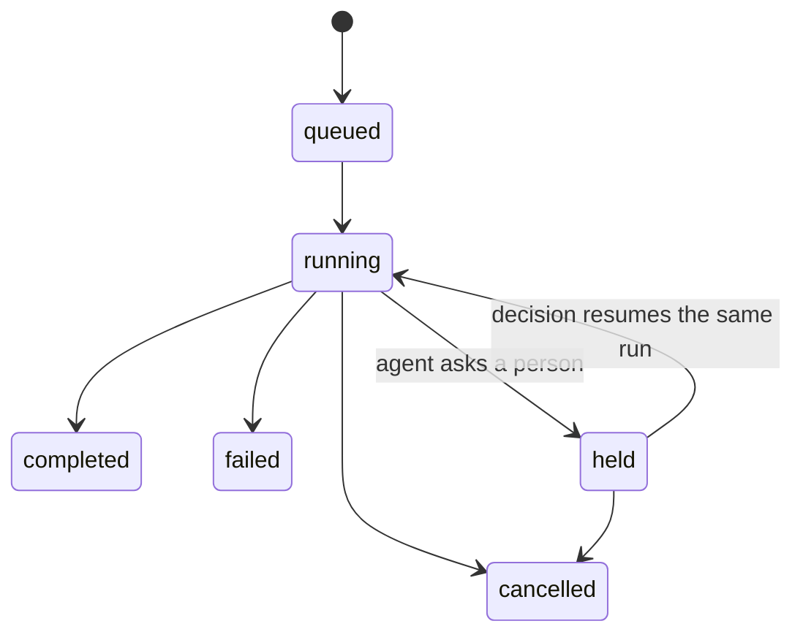

| Concept | What it is |
|---|---|
| **Agent** | A product with one or more capabilities. Owns its versions, config, secrets, state and memory. |
| **Capability** | One operation an agent offers, such as `quick_check` or `chat`. Declares an input and output JSON Schema, a timeout and who may approve its holds. |
| **Version** | Immutable. The container image plus its config. Changing a model, prompt or parameter makes a new version. |
| **Config** | Named `models`, `prompts` and `params`, fixed per version. Code asks for a model by **role** (`reader`) and the version maps it to a real model. |
| **Run** | One call of one capability. A run can invoke the agent several times: the start, then one resume per human decision. |
| **Session** | Groups the runs of one conversation. One chat turn is one run. |
| **End user** | The person a conversation is about, named on the session. Memory and run lists are scoped by it. |
| **Hold** | A run waiting for something, today a person's decision. |
| **Child run** | A run started by another run's code, linked to its parent. |
| **Environment** | A separate space for agents, models, guardrails and users, such as `staging` and `production`. |
| **Tenant** | A customer or group company. Holds environments. Tenants never see each other. |

## The life of a run

- The platform calls the agent's `POST /invoke` once per invocation, on the version the run started on.
- A held run has no token and nothing running. Its container may be stopped. The same run is invoked again after the decision.
- A run has at most 100 invocations.

## Roles

| Role | Can |
|---|---|
| **Member** | Run agents, read runs, decide holds when the capability allows it. |
| **Admin** | Also deploy, manage models, guardrails, webhooks and secrets. |
| **Tenant admin** | Manage the tenant's users, service accounts, API keys and environments. |

Scripts and outside systems use a **service account** with an API key (`Authorization: Bearer aos_...`). A key is shown once and revoking it takes effect immediately.
