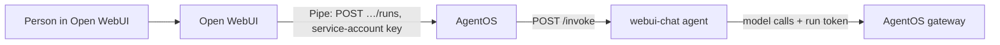

[Open WebUI](https://openwebui.com) is a chat interface, not an agent framework. Keep it as the UI your people already use, and run the agent itself on AgentOS. A small Open WebUI **Pipe** function makes the AgentOS agent show up as a model in Open WebUI's model list. Each message becomes an AgentOS run, so every conversation is logged, checked by guardrails, versioned and counted like any other run, and each Open WebUI user is the run's **end user**.

<Info>
Tested against the Pipe interface of Open WebUI v0.12.4. The agent passed the [conformance kit](/agentos/build/conformance), 12 checks including the streamed answer. The Pipe was tested by calling it the way Open WebUI does, against a stand-in for the AgentOS endpoints it uses: streaming, waiting, a held run, an error, and no run for Open WebUI's background tasks. It hasn't been run inside a live Open WebUI yet.
</Info>

## How it fits together



- **Open WebUI** keeps the chat history, the users and the interface.
- **The Pipe** sends the conversation to an AgentOS capability with a service account's API key. It opens one AgentOS session per Open WebUI chat, with the Open WebUI user as the session's end user.
- **The agent** runs on AgentOS and streams its answer as plain text. Open WebUI shows it as it is written.

## 1. Deploy the agent

The agent answers the conversation it is given and streams the text through the gateway. Any agent works, as long as its capability takes `{"messages": [...]}`. To stream, it answers with plain text; otherwise it returns `{"answer": "..."}`.

<CodeGroup>
```python app.py
"""The agent behind Open WebUI: answers the conversation and streams plain text as the model writes it."""

import agentos


def chat(inv: agentos.Invocation):
    messages = [{"role": "system", "content": inv.config["prompts"]["system"]}, *inv.input["messages"]]

    def pieces():
        answer = ""
        for delta in inv.llm.stream(messages):   # the gateway, with the run token
            answer += delta
            yield delta
        inv.set_output({"answer": answer})       # the run's output, reported before the stream ends

    # A caller that starts the run with ?passthrough=true gets this text as it is written;
    # one that waits (?wait=true) gets the output above.
    return agentos.Stream(pieces(), "text/plain; charset=utf-8")


if __name__ == "__main__":
    agentos.serve({"chat": chat}, port=8080)
```

```yaml agentos.yaml
name: webui-chat
title: Chat for Open WebUI
description: Answers a chat conversation, streaming its text so Open WebUI shows it as it is written.
runtime: stateless
port: 8080
capabilities:
  chat:
    description: Answers the last message of a conversation.
    input:
      type: object
      properties:
        messages:
          type: array
          items:
            type: object
            properties:
              role: {enum: [user, assistant]}
              content: {type: string}
            required: [role, content]
          minItems: 1
      required: [messages]
    output:
      type: object
      properties: {answer: {type: string}}
      required: [answer]
    timeout: 5m
config:
  models: {main: openai/gpt-4o-mini}
  prompts: {system: "You are the company's helpful assistant. Answer briefly."}
```

```dockerfile Dockerfile
{agent/Dockerfile}
```
</CodeGroup>

The SDK wheel goes into `vendor/` (see [SDKs](/agentos/build/sdks#putting-the-sdk-in-your-bundle)). Deploy it as `webui-chat` (see [Deploying](/agentos/platform/deploying)). For the streaming side of the agent, see [Streaming answers](/agentos/build/streaming).

## 2. Create an API key for Open WebUI

On the **Users** page, add a service account for Open WebUI, give it the **member** role in the agent's environment, and create an API key. The key is shown once. See [Users and API keys](/agentos/platform/users-and-api-keys).

The key stays on the Open WebUI server, in the Pipe's settings. It never reaches the browser.

## 3. Add the Pipe to Open WebUI

In Open WebUI, open **Admin Panel → Functions**, create a new function, paste the code below and save it. Then open the function's **Valves** (the gear icon) and set your AgentOS address, the API key, the environment, the agent and the capability. Enable the function: it appears in the model list under the function's name.

```python agentos_pipe.py
"""
title: AgentOS
description: Chat with an agent that runs on AgentOS. Open WebUI stays the chat UI; AgentOS runs, governs and logs the agent.
version: 0.1.0
"""

import json

import httpx
from pydantic import BaseModel, Field


def _text(content) -> str:
    """Open WebUI message content: a string, or a list of parts (text, images) for multimodal messages."""
    if isinstance(content, str):
        return content
    return "".join(part.get("text", "") for part in content or [] if isinstance(part, dict))


def _problem(response: httpx.Response) -> str:
    try:
        error = response.json()
        return f"AgentOS: {error.get('message') or error.get('code')} (HTTP {response.status_code})"
    except ValueError:
        return f"AgentOS: HTTP {response.status_code}"


class Pipe:
    class Valves(BaseModel):
        AGENTOS_URL: str = Field(default="https://agentos.example.com", description="Your AgentOS address")
        AGENTOS_API_KEY: str = Field(default="", description="A service account's API key (aos_…), member role")
        ENVIRONMENT: str = Field(default="default", description="The environment the agent is deployed to")
        AGENT: str = Field(default="webui-chat", description="The agent's name")
        CAPABILITY: str = Field(default="chat", description="The capability to run for each message")
        STREAM: bool = Field(default=True, description="Show the answer as the agent writes it (passthrough)")

    def __init__(self):
        self.valves = self.Valves()
        self.sessions: dict[str, str] = {}   # Open WebUI chat id → AgentOS session id

    async def pipe(self, body: dict, __user__: dict, __chat_id__: str | None = None, __task__: str | None = None):
        if __task__:
            return   # titles, tags and follow-up suggestions: don't start an agent run for them

        v = self.valves
        base = f"{v.AGENTOS_URL.rstrip('/')}/v0/envs/{v.ENVIRONMENT}"
        messages = [{"role": m["role"], "content": _text(m.get("content"))}
                    for m in body.get("messages", []) if m.get("role") in ("user", "assistant")]
        url = f"{base}/agents/{v.AGENT}/capabilities/{v.CAPABILITY}/runs"

        async with httpx.AsyncClient(headers={"Authorization": f"Bearer {v.AGENTOS_API_KEY}"},
                                     timeout=httpx.Timeout(10, read=330)) as client:
            run = {"input": {"messages": messages}}
            if __chat_id__:
                session_id = await self._session(client, base, __chat_id__, __user__)
                if session_id is None:
                    yield "AgentOS: couldn't open a session for this chat."
                    return
                run["session_id"] = session_id

            if body.get("stream") and v.STREAM:
                # The agent's own stream, as it writes it (plain text from the example agent).
                async with client.stream("POST", url, params={"passthrough": "true"}, json=run) as response:
                    if response.status_code >= 400:
                        await response.aread()
                        yield _problem(response)
                        return
                    if response.headers.get("content-type", "").startswith("application/json"):
                        await response.aread()   # the agent answered without streaming, or the run is held
                        yield self._answer(response.json())
                        return
                    async for text in response.aiter_text():
                        yield text
            else:
                response = await client.post(url, params={"wait": "true"}, json=run)
                yield _problem(response) if response.status_code >= 400 else self._answer(response.json())

    async def _session(self, client: httpx.AsyncClient, base: str, chat_id: str, user: dict) -> str | None:
        """One AgentOS session per Open WebUI chat, naming the Open WebUI user as the session's end user."""
        if chat_id not in self.sessions:
            response = await client.post(f"{base}/sessions", json={"user": user["id"]} if user.get("id") else {})
            if response.status_code >= 400:
                return None
            self.sessions[chat_id] = response.json()["session_id"]
        return self.sessions[chat_id]

    @staticmethod
    def _answer(run: dict) -> str:
        if run.get("status") == "completed":
            output = run.get("output") or {}
            return output.get("answer") if isinstance(output, dict) and "answer" in output else json.dumps(output)
        if run.get("status") == "held":
            return f"Waiting for a person's approval in AgentOS (run {run['run_id']})."
        error = run.get("error") or {}
        return f"AgentOS: the run {run.get('status')} ({error.get('code', 'no code')}: {error.get('message', '')})"
```

| Valve | What it is |
|---|---|
| `AGENTOS_URL` | Your AgentOS address, for example `https://agentos.example.com`. |
| `AGENTOS_API_KEY` | The service account's API key (`aos_…`). |
| `ENVIRONMENT`, `AGENT`, `CAPABILITY` | Which capability each message runs. |
| `STREAM` | Show the answer as the agent writes it (`?passthrough=true`). Off, the Pipe waits for the run and shows its output (`?wait=true`). |

## What each message does

<Steps>
  <Step title="A session for the chat">
    The first message of an Open WebUI chat creates an AgentOS session with `{"user": "<Open WebUI user id>"}`. Later messages of the chat reuse it. Runs, memory and erasure are then per end user (see [Sessions API](/agentos/api/sessions)).
  </Step>
  <Step title="A run per message">
    The Pipe sends the chat's user and assistant messages as the input. Open WebUI's own system prompt is left out: the agent's prompt is part of its version on AgentOS.
  </Step>
  <Step title="The answer">
    With `STREAM` on, the run starts with `?passthrough=true` and the agent's text reaches the chat as it is written. Otherwise the run starts with `?wait=true` and the Pipe shows `output.answer`. A run that waits for a person shows a short note with the run id, and an error shows AgentOS's message.
  </Step>
</Steps>

## Things to know

- **Background tasks don't start runs.** Open WebUI also calls the selected model to write chat titles, tags and follow-up suggestions. The Pipe returns nothing for those (`__task__`), so they don't cost an agent run. To keep the generated titles, choose another model for them in Open WebUI's admin settings.
- **The session map lives in memory.** The Pipe remembers which AgentOS session belongs to which chat while Open WebUI runs. After a restart, a chat's next message opens a new session. Nothing is lost, because Open WebUI sends the whole conversation every time.
- **One message at a time per chat.** A session runs one turn at a time. A second message while the first is still running gets `409 session_busy` from AgentOS, which the Pipe shows.
- **Approvals happen in AgentOS.** When the agent asks a person, the run is held and the chat shows a note. The reviewer decides in the AgentOS [Review queue](/agentos/platform/review-queue).

## Next steps

<CardGroup cols={2}>
  <Card title="Runs API" icon="terminal" href="/agentos/api/runs">
    Waiting, passthrough streaming and idempotency in detail.
  </Card>
  <Card title="Framework examples" icon="cubes" href="/agentos/frameworks/overview">
    Agents built with CrewAI, MCP and other frameworks.
  </Card>
</CardGroup>
