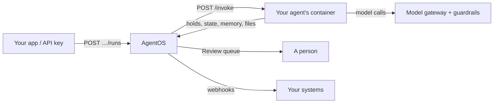

AgentOS is where your company's AI agents run. You write an agent in whatever language or framework your team prefers — plain Python, TypeScript, LangGraph, the OpenAI Agents SDK, Agno, Mastra, the Vercel AI SDK, Upsonic, anything that can serve HTTP — package it with a `Dockerfile`, and upload it. AgentOS builds it, runs it, and puts the same controls around every agent:

- **Model access** through one gateway, with each environment's own providers and models, and tokens and cost recorded per run.
- **Guardrails** that check what goes to and comes from the models (national IDs, IBANs, card numbers, secrets, your own patterns), and **network guardrails** that decide which hosts an agent may reach.
- **Human approvals**: an agent can stop and ask a person, and continue with their decision.
- **Memory**, **state** and **sessions** kept by the platform, so agents stay stateless.
- **Evals** that score a version on a dataset before it takes traffic, and compare models and prompts.
- **An audit log** of every action, and **webhooks** to tell your other systems what happened.

<Info>
AgentOS is framework and language agnostic by design. Everything an agent does with the platform is a plain HTTP call, so the [Python and TypeScript SDKs](/agentos/build/sdks) are a convenience, never a requirement.
</Info>

## How it works

1. You upload a **bundle**: a zip with your code, a `Dockerfile` and an `agentos.yaml` that names the agent's **capabilities** and their input and output schemas.
2. AgentOS builds an image, starts a container and waits until it answers `GET /health`. That is a new **version** of the agent.
3. A caller starts a **run** of a capability. AgentOS checks the input against the schema and calls your container's `POST /invoke` with it, plus a short-lived **run token**.
4. With that token your code calls models through the gateway, keeps state, saves memory, uploads files, starts child runs or asks a person for a decision.
5. Your code answers `completed` with an output, `failed` with an error, or `suspended` while a person decides. The run, its model calls, tokens, cost and every event are on the run page.

## Key concepts

| Concept | What it is |
|---|---|
| **Environment** | A space with its own agents, models, guardrails, users' roles and data (`default`, `staging`, `prod`…). |
| **Agent** | A named service you deploy, made of versions. |
| **Version** | One build of a bundle (`v1`, `v2`…). One version is **live**; others can be **candidates** for evals, or older versions you can roll back to. |
| **Capability** | One thing an agent can do, such as `read_invoice` or `chat`, with a JSON Schema for its input and output and a timeout. |
| **Run** | One call of a capability. It is `queued`, `running`, `held`, then `completed`, `failed` or `cancelled`. |
| **Hold** | A question an agent asks a person (approve, edit, reject or give feedback). The run waits while it is open. |
| **Session** | A group of runs that share a conversation's state, optionally for one **end user** of your app. |
| **Run token** | The credential an agent gets for one invocation. It reaches the gateway and the platform, and stops working when the agent answers. |

## Roles

Everyone works inside environments with one of two roles:

- **Members** run agents, read runs, decide approvals they are allowed to, and work on evals.
- **Admins** also deploy agents and change models and providers, guardrails, secrets, webhooks and network rules. Members can see these settings (never a secret's value) but not change them.

Scripts and other systems use a **service account** with an API key. See [Users and API keys](/agentos/platform/users-and-api-keys).

## Next steps

<CardGroup cols={2}>
  <Card title="Quickstart" icon="rocket" href="/agentos/get-started/quickstart">
    Deploy your first agent and run it, in the panel and with the API.
  </Card>
  <Card title="Build an agent" icon="hammer" href="/agentos/build/agent-contract">
    The two endpoints every agent serves, and what it gets on each run.
  </Card>
  <Card title="SDKs" icon="code" href="/agentos/build/sdks">
    Python and TypeScript helpers for approvals, state, memory and models.
  </Card>
  <Card title="API reference" icon="terminal" href="/agentos/api/overview">
    Deploy, run, decide and evaluate from your own code.
  </Card>
</CardGroup>
