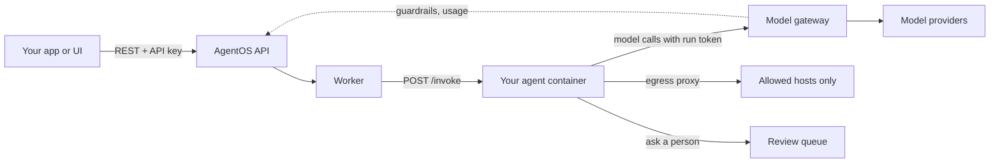

## What AgentOS is

AgentOS is a self-hosted platform that sits **around** your agents. The agent code stays yours, in any framework and any language. AgentOS gives it a place to run and a control layer that every model call, tool call and human decision passes through.

<CardGroup cols={2}>
  <Card title="Bring any agent" icon="plug" href="/agentos/build/bring-your-own-agent">
    LangGraph, OpenAI Agents SDK, Agno, CrewAI, Vercel AI SDK, Mastra or plain HTTP. An agent is a container with two endpoints.
  </Card>
  <Card title="Keep your own UI" icon="window" href="/agentos/run/runs-api">
    Your chat app or backend calls a REST API. Streaming answers reach your UI byte for byte.
  </Card>
  <Card title="Govern every call" icon="shield-check" href="/agentos/govern/guardrails">
    Block or mask personal data and secrets at the model gateway, before the provider sees them.
  </Card>
  <Card title="Measure quality" icon="chart-line" href="/agentos/quality/evals">
    Test sets, checks and AI judges that compare versions and models on score, cost and speed.
  </Card>
</CardGroup>

## How it fits together

| Part | What it does |
|---|---|
| **Panel and API** | Deploy agents, start runs, review decisions, manage users, models and guardrails. |
| **Worker** | Builds agent images, starts containers, calls `POST /invoke`, waits for people durably. |
| **Model gateway** | One OpenAI-compatible address for every provider. Authenticates by a short-lived run token, applies guardrails, records tokens and cost. |
| **Egress proxy** | Agent containers have no route out. Only hosts you allow are reachable. |
| **Agent containers** | Your code. Each agent runs on its own isolated network. |

## Available now and planned

Every page in this section says what exists today. Anything that does not exist yet is marked <Badge color="orange">Planned</Badge> and collected on the [Roadmap](/agentos/roadmap). A planned item may change before it ships.

| Area | Available now | Planned |
|---|---|---|
| Deploy | Zip upload, candidate versions, promote, rollback | Git-connected deploys, eval gate on promote |
| Run | REST API, sessions, streaming passthrough, child runs, webhooks | MCP and A2A front doors, run an older version on request |
| Humans | Review queue, approve, edit, reject, feedback | Callback and wait-for-runs holds |
| Memory | Per-agent facts, per-end-user folders, version history, erase | Automatic extraction, embeddings |
| Guardrails | Personal data, secrets, keywords, own patterns, network rules | Per-person and per-team scopes |
| Evals | Datasets, evaluators, AI judge, experiments, model comparison | Scheduled evals, live-traffic scoring, drift alerts |
| Operate | Dashboard, run timeline, webhooks | OpenTelemetry, alerts, retention policies |

## Where to go next

<CardGroup cols={2}>
  <Card title="Quickstart" icon="rocket" href="/agentos/quickstart">
    Install AgentOS and deploy your first agent.
  </Card>
  <Card title="Core concepts" icon="book" href="/agentos/concepts">
    Agents, capabilities, versions, runs, sessions and holds.
  </Card>
</CardGroup>
